# How to: step-by-step tutorials

Short tutorials for the LNP Patent Desk with real screenshots. The same text is in the app under **How to** (`#howto`, a single tutorial at `#howto-markush`).
The screenshots show the website build in the light theme (made by `tests/howto_shots.cjs`); the Claude features exist only in the claude.ai Artifact version.
Everything shown is a pre-screening aid, not legal advice.

This file is generated from `web/app/views/lib/howto-data.js` by `node tests/howto_docs.cjs`; edit the data file, not this one.

## Contents

1. [Getting started](#1-getting-started)
2. [Searching patents](#2-searching-patents)
3. [Reading a patent page](#3-reading-a-patent-page)
4. [Structure search](#4-structure-search)
5. [FTO pre-screening](#5-fto-pre-screening)
6. [Markush check](#6-markush-check)
7. [Library screen](#7-library-screen)
8. [Range check](#8-range-check)
9. [Design-around ideas](#9-design-around-ideas)
10. [Earliest disclosure and white space](#10-earliest-disclosure-and-white-space)
11. [Expiry timeline](#11-expiry-timeline)
12. [Similar patents](#12-similar-patents)
13. [Watchlist and saved searches](#13-watchlist-and-saved-searches)
14. [Using the data with your own AI](#14-using-the-data-with-your-own-ai)
15. [About the data](#15-about-the-data)

## Words used in these tutorials

- **Patent family**: All publications that go back to the same first filing, for example the European and the US version of one invention. The tool counts families, not single documents, where it matters.
- **Claims**: The legally decisive part of a patent: they define what is protected. An independent claim stands alone; dependent claims add features to another claim.
- **FTO (freedom to operate)**: The question whether you may make and sell a product without infringing patents of others. The tool only pre-screens; a patent attorney decides.
- **Markush formula**: A general chemical formula in a claim with variable parts (R groups, chain lengths). It covers many molecules at once, so a molecule can be inside the claim without being named in it.
- **SMILES**: A line of text that writes a molecule, for example CCO for ethanol. Names of well-known lipids (SM-102, ALC-0315 ...) work in most molecule fields as well.
- **CPC**: Cooperative Patent Classification: the subject codes of patents, for example A61K 9/127 for liposomes.
- **PTA / PTE / SPC**: Patent term adjustment (US) and extensions (US PTE, European SPC) that can lengthen a patent beyond the usual 20 years from filing. The expiry dates in the tool are estimates and do not check PTE or SPC.
- **Kind code**: The letter and digit after a patent number: A1 is an application, B1 or B2 a granted patent.
- **mol %**: Molar percentage: the share of one lipid among all lipids by number of molecules. Lipid nanoparticle recipes (LNP) are usually written this way.

## 1. Getting started

Find your way around: the layout, the quick jump with Ctrl or Cmd + K and the appearance setting.

Try it in the app: `#suche`

**Step 1.** The top band shows what is in this build: patents, patent families, full texts, claims and extracted compounds. The left rail has the main sections: Search, Structure, Products, FTO, Landscape, Watchlist, How to (this page), Tools and System. On a phone the rail sits at the bottom. The big area on the right is the work area of the current section.

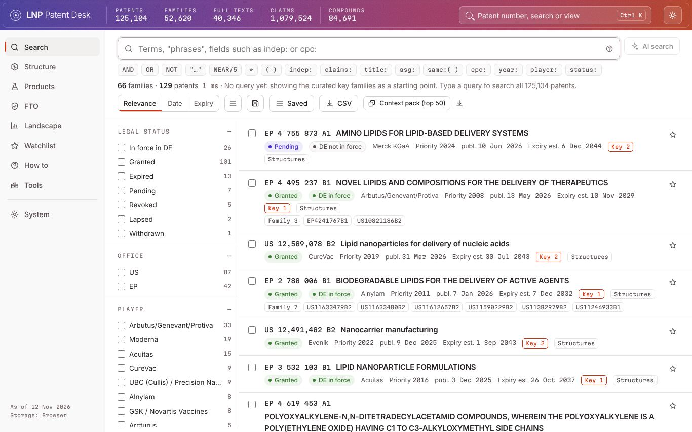

**Step 2.** Press Ctrl + K (Cmd + K on a Mac) anywhere, or click the field in the top band. Type a patent number to open it, any words to search, or the name of a section to jump there. Press Enter to take the first suggestion, Esc to close. Press ? for the list of keyboard shortcuts (for example j and k to move through results, s to put a result on the watchlist).

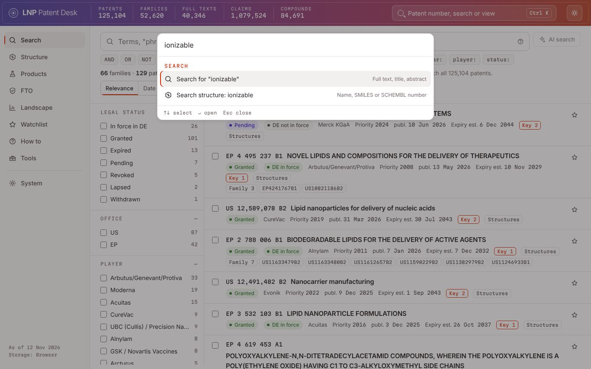

**Step 3.** The round button at the right end of the band changes the appearance: automatic (follows your device), light or dark. The footer of the rail says how old the data is and where your own notes and saved work are stored.

**Step 4.** Not sure where to begin? Search finds patents by words, Structure finds them by molecule, Tools holds the checks for a specific molecule or formulation, FTO pre-screens a whole product. The other tutorials in this list walk through each of them.

**Limits**

- The keyboard shortcuts work when the cursor is not in a text field.
- Corpus snapshot: every result comes from the patents in this build, as of the snapshot date shown on the System page. Patents that are not in the corpus, or have no full text, are not searched.
- Legal status and expiry dates are estimates from public register data of that snapshot; they can be out of date or wrong.
- Pre-screening aid, not legal advice. Have the result checked by a patent attorney before you rely on it.
- Claude features (AI search help, FTO analysis, reading formula images) exist only in the claude.ai Artifact version. The public website has none of them; every tool has a manual mode.

## 2. Searching patents

Search the claims, titles and abstracts, narrow the result with filters, and open a patent.

Try it in the app: `#suche`

**Step 1.** Type words into the search box and press Enter. Here: ionizable lipid mRNA. The list shows each patent with its legal status, the owner, the priority year, the estimated expiry and the claim passages where your words occur (highlighted). Without a query the page shows a curated set of key families as a starting point.

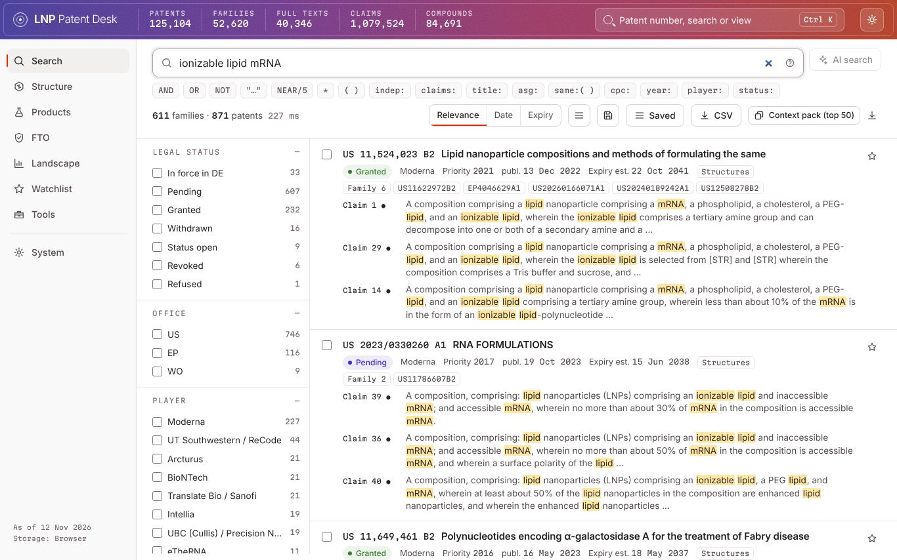

**Step 2.** The filters on the left narrow the list and show how many patents each choice would leave: legal status, office (US, EP, WO), owner, year, patent class (CPC) and kind code. Tick Granted to keep only granted patents. Chosen filters appear as chips above the list and can be removed there.

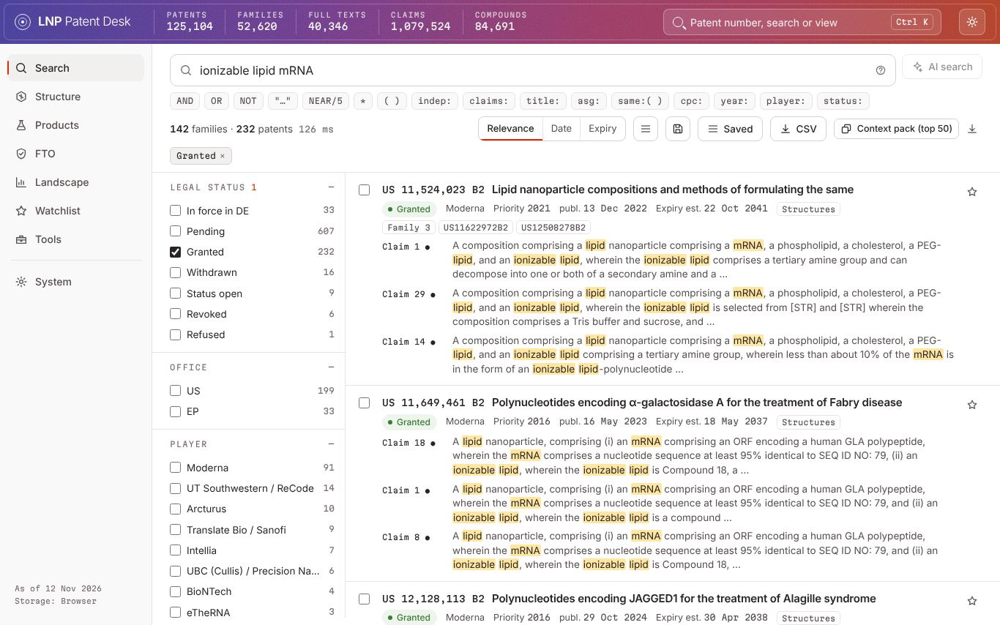

**Step 3.** The buttons under the box write the search syntax for you: AND, OR, NOT, "phrase", NEAR/5 (words close together), * (any ending) and fields such as title:, claims:, indep: (independent claims only), asg: (owner), cpc:, year: and status:. Example: title:"lipid nanoparticle" asg:Moderna. Switch the order with Relevance, Date or Expiry; save the search with the disk button; export the list with CSV.

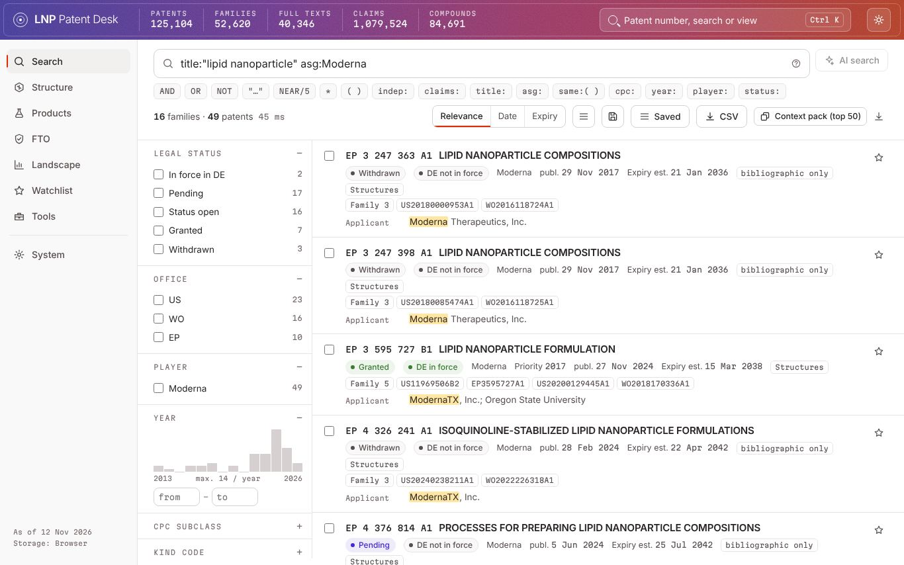

**Step 4.** Click a title to open the patent page (next tutorial). The star puts a patent on your watchlist; tick the boxes to select several: a bar at the bottom then offers Watch (all selected) and Check FTO (hand them to the FTO section).

**Limits**

- Search covers only patents with a full text in the corpus; a patent shown without claim passages is listed from its bibliographic data only.
- Words are matched as written (with simple stemming). A concept described with other words is not found: try synonyms and chemical names.
- The number of hits is the number in the corpus, not the number of patents in the world.
- Corpus snapshot: every result comes from the patents in this build, as of the snapshot date shown on the System page. Patents that are not in the corpus, or have no full text, are not searched.
- Legal status and expiry dates are estimates from public register data of that snapshot; they can be out of date or wrong.
- Pre-screening aid, not legal advice. Have the result checked by a patent attorney before you rely on it.
- Claude features (AI search help, FTO analysis, reading formula images) exist only in the claude.ai Artifact version. The public website has none of them; every tool has a manual mode.

## 3. Reading a patent page

Status, dates, claims, family and the legal timeline of one patent, with the example EP 3 532 103 B1.

Try it in the app: `#patent-EP3532103B1`

**Step 1.** The top shows the number, the legal status (Granted, Pending, Lapsed ...), whether the patent is in force in Germany, the key family it belongs to, the title and the owner. Below are the buttons: Watch, Compare family, Check FTO, Context pack, Expiry timeline and Similar patents. The date cards give the estimated expiry with its basis (filing date plus 20 years), the priority, filing, publication and grant dates.

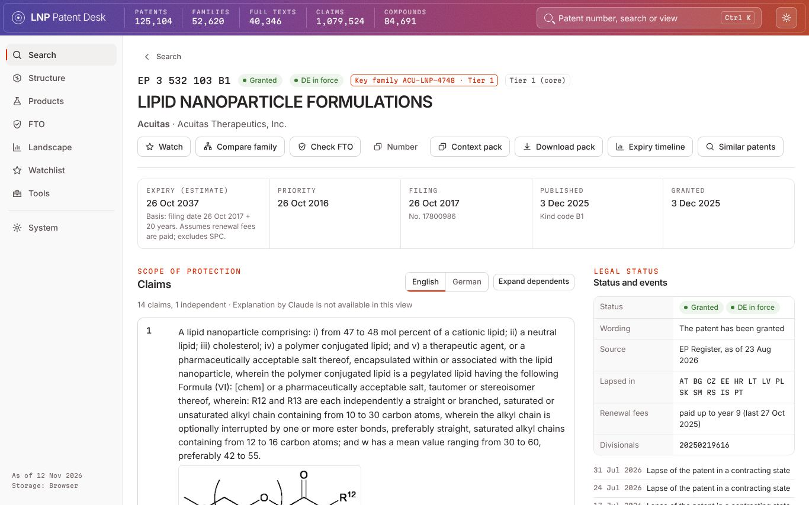

**Step 2.** Claims are the part that matters. The first claim is shown in full with its formula image; use Expand dependents to see the dependent claims, English or German to switch the language, and Copy or Link on a claim. Check Markush on a formula claim opens the Markush check (see that tutorial). On the right the box "Status and events" lists what the register says: lapses, fees, divisionals and the source and date of that information.

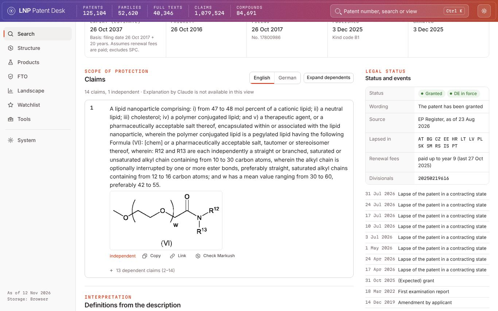

**Step 3.** Further down: definitions taken from the description, the compounds found in the patent (open one in structure search), the abstract and the legal and prosecution timeline from the earliest priority to the estimated expiry. "Show more entries" reveals older events. Then come numeric ranges found in the claims, the members of the patent family, classification (CPC), links to Espacenet, the EP Register, Google Patents, PATENTSCOPE, Lens and SureChEMBL, and a private tag and note field.

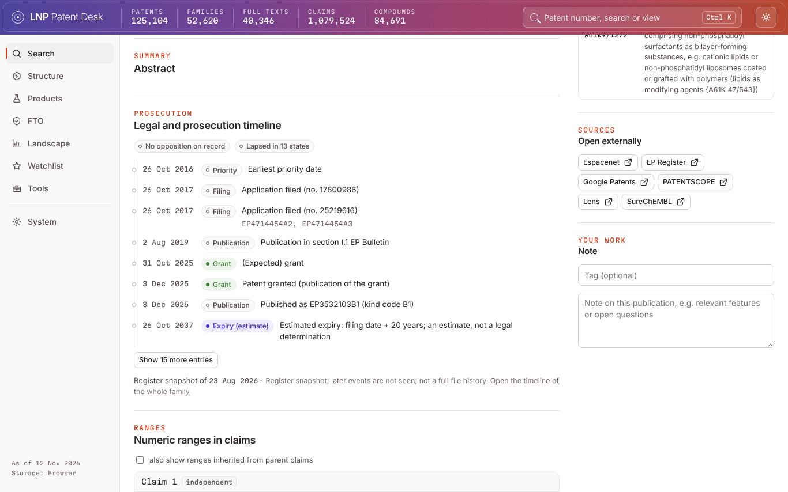

**Limits**

- Claim text and status are shown as stored in the snapshot. Check the official register before relying on a date or a status.
- The explanation of claims by Claude is only available in the claude.ai Artifact version.
- The expiry date is an estimate from the filing date; extensions (PTE, SPC), terminal disclaimers and unpaid fees are not all checked.
- Corpus snapshot: every result comes from the patents in this build, as of the snapshot date shown on the System page. Patents that are not in the corpus, or have no full text, are not searched.
- Legal status and expiry dates are estimates from public register data of that snapshot; they can be out of date or wrong.
- Pre-screening aid, not legal advice. Have the result checked by a patent attorney before you rely on it.
- Claude features (AI search help, FTO analysis, reading formula images) exist only in the claude.ai Artifact version. The public website has none of them; every tool has a manual mode.

## 4. Structure search

Find lipids and the patents that mention them, by molecule instead of by words.

Try it in the app: `#struktur`

**Step 1.** Enter a SMILES, a name of a well-known lipid (here SM-102) or a SureChEMBL number and press Search. The buttons below the box fill in common LNP lipids. Alternatively open "Draw structure" and draw the molecule. The box under the mode buttons shows the molecule that was understood, with its tails, head group and linkers.

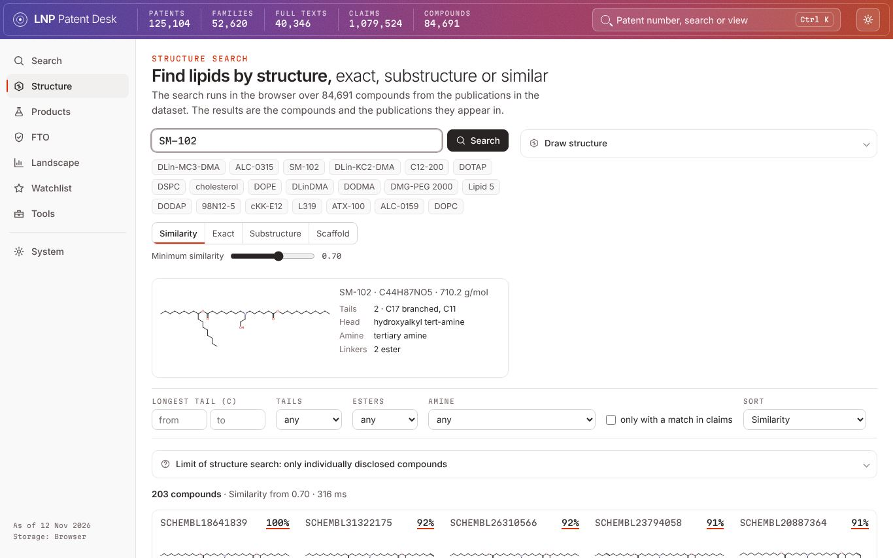

**Step 2.** Choose the mode. Similarity lists look-alikes with a percentage (move the slider for the minimum). Exact finds the same molecule. Substructure finds every compound that contains your molecule or fragment. Scaffold groups by the core. Filters narrow by tail length, number of tails, esters and amine type; "only with a match in claims" keeps compounds that appear in a claim.

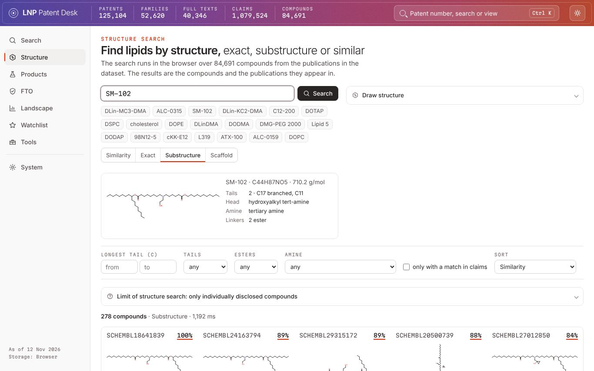

**Step 3.** Each result card is one compound with the number of publications that disclose it and where (claims, description, abstract, formula image). Click a card to open its details with the patents that mention it and their legal status, plus buttons to search similar compounds or the same scaffold, or to copy the SMILES.

**Limits**

- Only compounds that were extracted from the patents (84,691 in this build) can be found: structures that appear only in images or drawn as general formulas are not searched here (use the Markush check for those).
- "Appears in a claim" means the text of the claim contains it; it does not say that the claim protects it.
- The extraction of structures can contain errors.
- Corpus snapshot: every result comes from the patents in this build, as of the snapshot date shown on the System page. Patents that are not in the corpus, or have no full text, are not searched.
- Legal status and expiry dates are estimates from public register data of that snapshot; they can be out of date or wrong.
- Pre-screening aid, not legal advice. Have the result checked by a patent attorney before you rely on it.
- Claude features (AI search help, FTO analysis, reading formula images) exist only in the claude.ai Artifact version. The public website has none of them; every tool has a manual mode.

## 5. FTO pre-screening

How the guided pre-screening of a product against patents works, and what you can do on the website without Claude.

Try it in the app: `#fto`

**Step 1.** FTO means freedom to operate: may you sell this product without infringing someone else's patent? The FTO section checks a product profile against patents, element by element. Step 1 is the product: on the Products page create a profile with your lipids (with structure and share in mol %), payload, particle properties, process, use and markets. "Use example profile" loads a generic one to try.

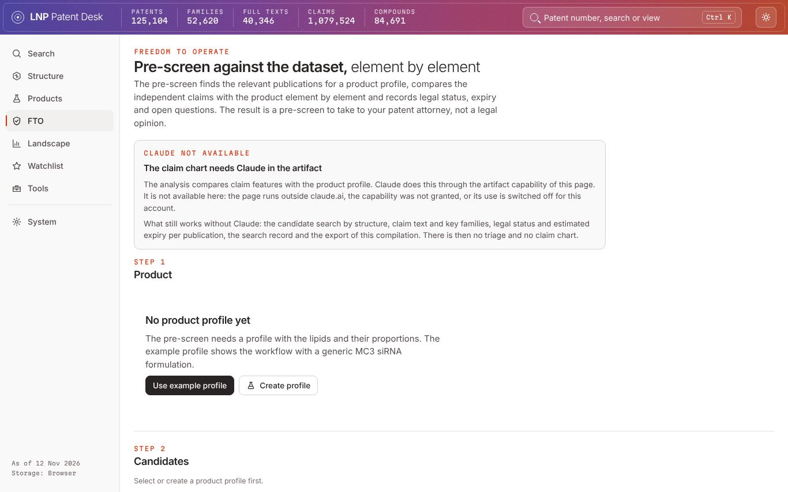

**Step 2.** Step 2 selects the candidates: the patents the profile is checked against, found by search, by structure and by your watchlist. Step 3 sets the depth: Quick (triage and claim charts for 5 patents), Standard (10) or Deep (20). The pre-screen then compares each independent claim with your profile feature by feature, notes the legal status and estimated expiry per patent, and lists open questions.

**Step 3.** The claim chart itself is written with Claude, so it runs only in the claude.ai Artifact version. On the public website the page shows the notice you see above; everything before the analysis still works there: the product profile, the search for candidates, and the other tools (Markush check, range check, structure search, expiry timeline). Saved pre-screens appear at the bottom of the page.

**Step 4.** Take the result to your patent attorney. The checks that code can do (quotes found in the claim text, numeric ranges, structure matches) are computed; Claude only translates and explains.

Try it: `#produkte`

**Limits**

- FTO output is a pre-screening, not legal advice and not an opinion on infringement or validity.
- Only the independent claims of the selected candidates are compared; patents outside the corpus, pending applications that may change, and other countries are not covered.
- The full run needs Claude and is only in the claude.ai Artifact version; the website shows what is possible without it.
- Corpus snapshot: every result comes from the patents in this build, as of the snapshot date shown on the System page. Patents that are not in the corpus, or have no full text, are not searched.
- Legal status and expiry dates are estimates from public register data of that snapshot; they can be out of date or wrong.
- Pre-screening aid, not legal advice. Have the result checked by a patent attorney before you rely on it.
- Claude features (AI search help, FTO analysis, reading formula images) exist only in the claude.ai Artifact version. The public website has none of them; every tool has a manual mode.

## 6. Markush check

Is a molecule inside the general formula of a claim? Shown with SM-102 and a curated claim of EP 3 350 157 B1.

Try it in the app: `#markush`

**Step 1.** A Markush formula is a general formula in a claim with variable groups, so the molecule need not be named in the patent to be covered. Step 1: enter the molecule (a SMILES, or a name such as SM-102) and press Check. The picture and the formula confirm what was understood.

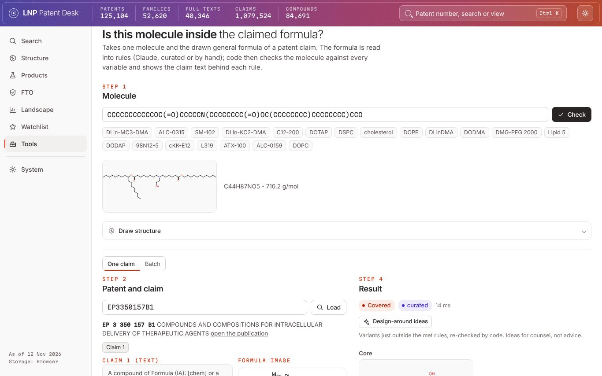

**Step 2.** Step 2: enter the patent number and press Load, then choose the claim. Curated records exist for a few patents (EP2350043B9, EP3221293B1, EP3350157B1, EP3368507B1, EP3766916B1); for them the formula is already translated into rules and marked "curated". For other patents the translation needs Claude (Artifact version) or your own rules typed into the rule editor (manual mode, "Edit by hand").

**Step 3.** Step 4 shows the verdict: here Covered, with the label "curated". Below it, Core says whether the common core of the formula was found in the molecule, and a table lists each variable of the claim with the verdict (met, not met), your fragment, the rule and the sentence of the claim it comes from. Quotes are checked against the claim text by code and marked "verified in the claim text".

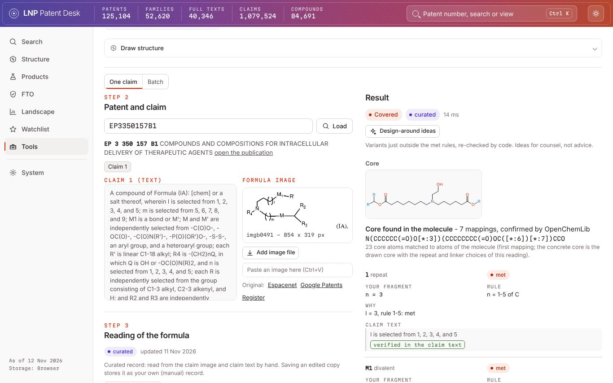

**Step 4.** Scroll through the table: every variable (chain length l, linkers M and M1, groups R2 and R3 ...) must be met for the molecule to be inside. One not-met row is enough to fall outside. "Design-around ideas" opens variants just outside the rules (see that tutorial). The Batch tab checks one molecule against all formula claims of a patent.

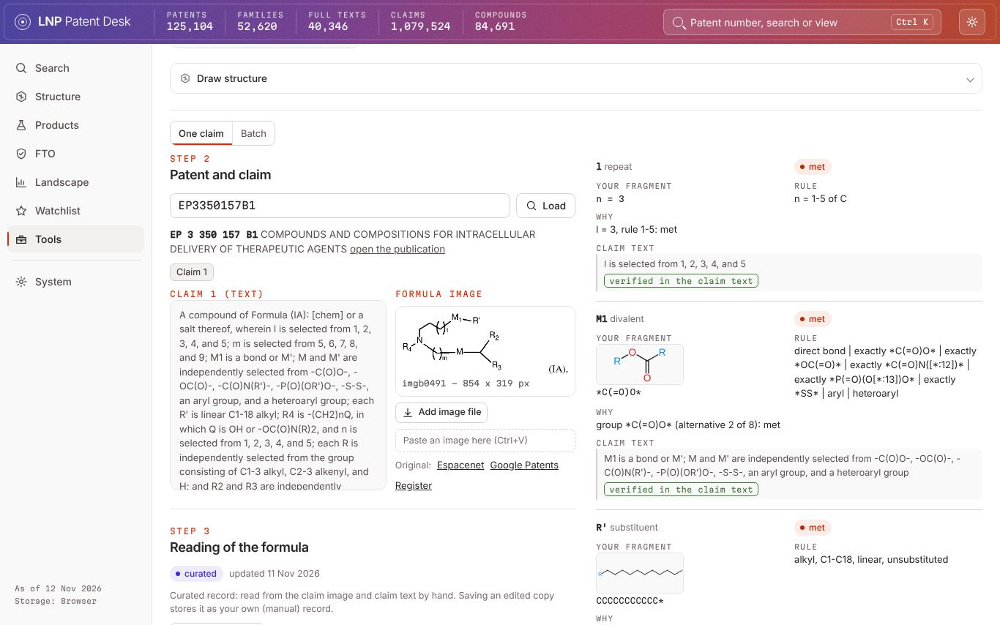

**Limits**

- A curated or machine-read formula can contain mistakes; read the claim itself.
- The check follows the literal wording of the claim. It does not cover equivalents, claim interpretation by a court or other claims of the patent.
- Without Claude only curated records and your own rules work; formula images are not read automatically.
- Corpus snapshot: every result comes from the patents in this build, as of the snapshot date shown on the System page. Patents that are not in the corpus, or have no full text, are not searched.
- Legal status and expiry dates are estimates from public register data of that snapshot; they can be out of date or wrong.
- Pre-screening aid, not legal advice. Have the result checked by a patent attorney before you rely on it.
- Claude features (AI search help, FTO analysis, reading formula images) exist only in the claude.ai Artifact version. The public website has none of them; every tool has a manual mode.

## 7. Library screen

Run a whole list of molecules against the corpus in one go.

Try it in the app: `#screen`

**Step 1.** Paste one molecule per line (SMILES or a known name) into the box, or load a CSV, TSV or SMI file (up to 5 MB) with "Load file". "Insert example" fills a sample. The table below shows each row and whether it was recognised as a structure. Here: SM-102, ALC-0315, DLin-MC3-DMA and a simple distearoyl lipid.

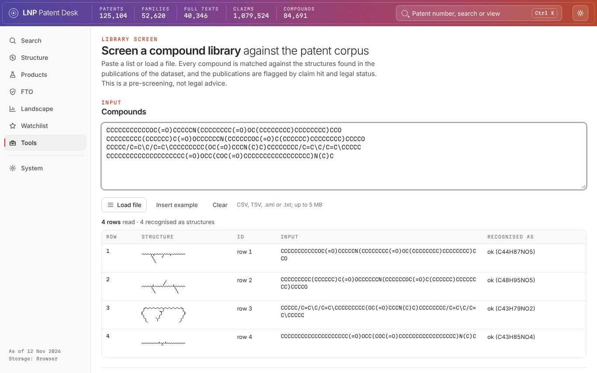

**Step 2.** Choose what to look for: Exact (with stereo variants), Similar (set the minimum similarity), Substructure (slow) and Markush check (against the curated formula records). Press Run screen.

**Step 3.** The summary shows how many compounds have a hit, how many appear in claims, how many in granted patents that are in force, and how many are covered by a Markush record. The table below flags each compound (for example "Exact, in claims, granted") with the counts of exact, similar and substructure hits and the number of publications. Filter by flag, sort the worst flag first, export with Export CSV, or keep the run with Save run.

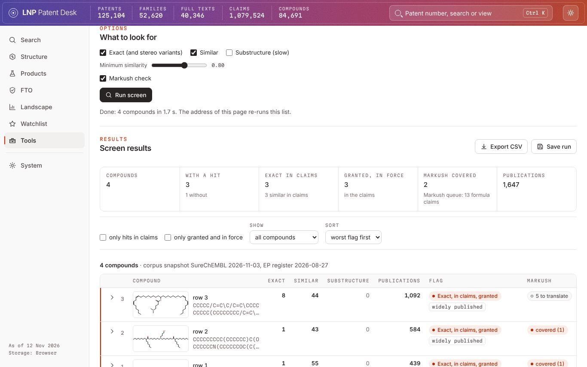

**Limits**

- Only structures extracted from the patents are matched; a patent that claims a general formula may cover a molecule without any hit here (use the Markush check).
- A hit means the compound occurs in a patent, not that you infringe it.
- The result is a pre-screening: status and dates are those of the snapshot.
- Corpus snapshot: every result comes from the patents in this build, as of the snapshot date shown on the System page. Patents that are not in the corpus, or have no full text, are not searched.
- Legal status and expiry dates are estimates from public register data of that snapshot; they can be out of date or wrong.
- Pre-screening aid, not legal advice. Have the result checked by a patent attorney before you rely on it.
- Claude features (AI search help, FTO analysis, reading formula images) exist only in the claude.ai Artifact version. The public website has none of them; every tool has a manual mode.

## 8. Range check

Compare the numbers of your formulation with the numeric ranges found in claims.

Try it in the app: `#ranges`

**Step 1.** Enter your values, one row each: choose the parameter (molar fraction in mol %, N/P ratio, particle size, pH ...), for mol % the component, and the value. Here: 50 mol % ionizable lipid, 10 mol % phospholipid, 38.5 mol % sterol (cholesterol), 1.5 mol % PEG lipid and a particle size of 80 nm. "Add value" adds a row, "Fill an example" fills a sample, or take the values from a saved product profile.

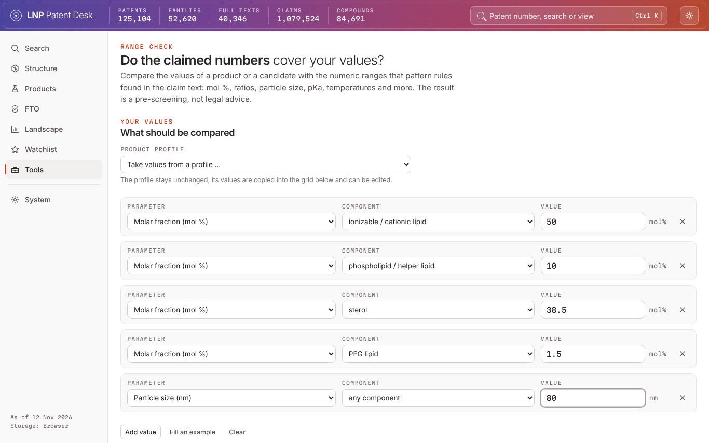

**Step 2.** Choose "All values inside" (claims whose ranges contain every value you gave) or "Any value inside", and press Check claims. The result lists the claims, grouped into claims with all values inside and claims with some values inside.

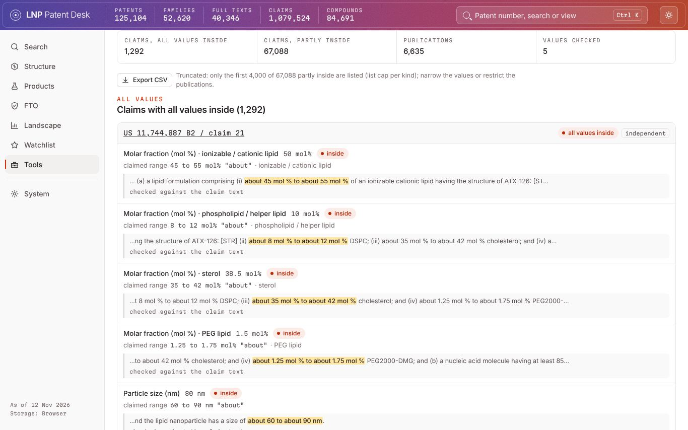

**Step 3.** Each claim shows, per value, the claimed range, the word that qualifies it (for example "about") and the passage of the claim, so you can check it. Export CSV saves the list. Open the patent from the claim number to read the claim in context.

**Limits**

- The ranges were read from the claim text by pattern rules; a range with an unusual wording can be missed or mis-read, and a range inside a claim does not mean the claim reads on your product.
- Only the numbers are compared, not the other features of the claim (lipid structure, payload, use).
- Long result lists are cut (the page says so); narrow the values to see all.
- Corpus snapshot: every result comes from the patents in this build, as of the snapshot date shown on the System page. Patents that are not in the corpus, or have no full text, are not searched.
- Legal status and expiry dates are estimates from public register data of that snapshot; they can be out of date or wrong.
- Pre-screening aid, not legal advice. Have the result checked by a patent attorney before you rely on it.
- Claude features (AI search help, FTO analysis, reading formula images) exist only in the claude.ai Artifact version. The public website has none of them; every tool has a manual mode.

## 9. Design-around ideas

Variants of a molecule that fall just outside one claimed formula, for discussion with counsel.

Try it in the app: `#designs`

**Step 1.** Enter the molecule (here SM-102), the patent (EP3350157B1) and the claim number (1) and press "Generate ideas". Code takes the Markush rule of that claim, finds the variables that the molecule meets, and changes one of them so that it just leaves the claimed range or group. The start point shows each variable and whether it is met.

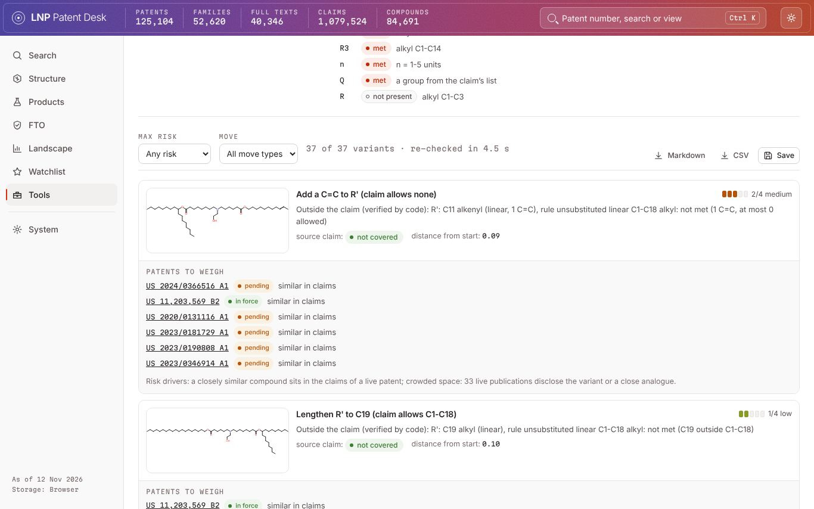

**Step 2.** Each idea says which rule it leaves ("Add a C=C to R'"), whether the new molecule is verified as outside the claim, how far it is from the start structure, a risk marker (low to high) and the patents to weigh: other publications in the corpus that disclose or claim a similar compound. Filter by maximum risk or kind of change, and export as Markdown or CSV or save.

**Limits**

- An idea generator, not advice: a variant outside the literal wording of a claim can still infringe by equivalence or through another claim or patent.
- Whether a variant can be made, is stable or works as a lipid is not checked.
- Needs a curated or hand-made Markush record for the claim; Claude can add the translation in the Artifact version and writes only the commentary.
- Corpus snapshot: every result comes from the patents in this build, as of the snapshot date shown on the System page. Patents that are not in the corpus, or have no full text, are not searched.
- Legal status and expiry dates are estimates from public register data of that snapshot; they can be out of date or wrong.
- Pre-screening aid, not legal advice. Have the result checked by a patent attorney before you rely on it.
- Claude features (AI search help, FTO analysis, reading formula images) exist only in the claude.ai Artifact version. The public website has none of them; every tool has a manual mode.

## 10. Earliest disclosure and white space

When did a lipid first appear in the corpus, and which parts of the chemistry are crowded or empty?

Try it in the app: `#disclosure`

**Step 1.** Open Earliest disclosure, enter a SMILES or a name (SM-102) and press "Show timeline". Choose how strict the match is: exact with stereo variants, exact only or similar. The figures give the earliest publication and the earliest priority date in the corpus, the earliest claim that contains it, and the numbers of publications and families. The timeline below draws one lane per patent family.

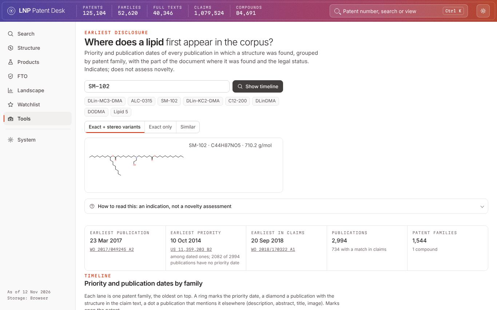

**Step 2.** The white-space map compares two structural features of all extracted lipids, for example longest tail against head group. The darker the cell, the more compounds, publications or families sit there; empty cells show combinations that nobody in the corpus disclosed. Click a cell to list its compounds and publications; change the axes or the count with the controls on top.

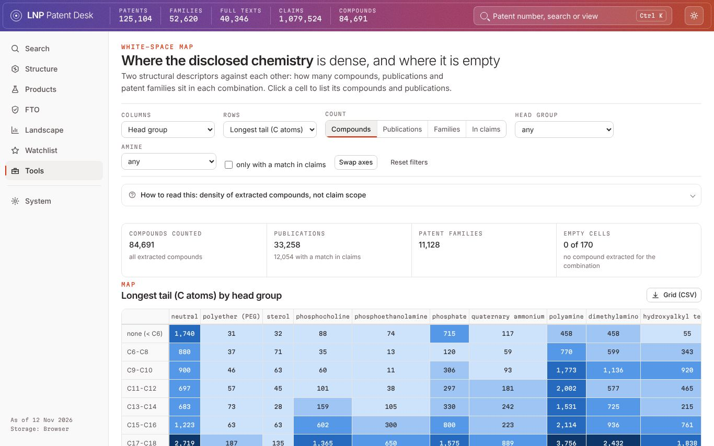

Try it: `#whitespace`

**Limits**

- Dates are those of documents in the corpus; an earlier disclosure outside it (papers, other patents, products) would not be shown. This is not a novelty assessment.
- An empty cell means "not found in this corpus", not "free to use" and not "new".
- Compounds come from automatic extraction and can be missing or wrong.
- Corpus snapshot: every result comes from the patents in this build, as of the snapshot date shown on the System page. Patents that are not in the corpus, or have no full text, are not searched.
- Legal status and expiry dates are estimates from public register data of that snapshot; they can be out of date or wrong.
- Pre-screening aid, not legal advice. Have the result checked by a patent attorney before you rely on it.
- Claude features (AI search help, FTO analysis, reading formula images) exist only in the claude.ai Artifact version. The public website has none of them; every tool has a manual mode.

## 11. Expiry timeline

When do the rights of a group of patents run out? Shown with four example patents.

Try it in the app: `#expiry`

**Step 1.** Choose a source: a product profile, an FTO opinion, your watchlist, a selection from the search, a list of compounds, or a list of publication numbers (shown here). Enter the numbers, choose the jurisdictions (EP, DE, US) and whether to include all family members, then press "Build timeline".

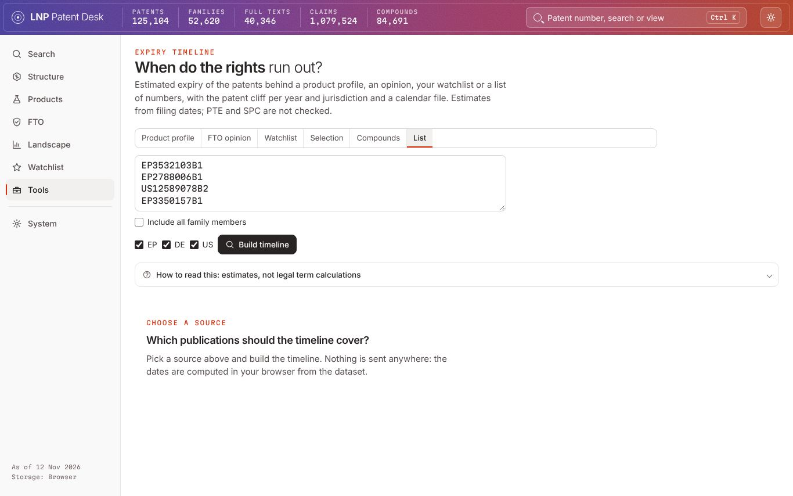

**Step 2.** The summary counts the rights in force, pending, no longer in force and expired, and gives the latest estimated expiry. The chart shows one bar per patent from the filing date to the estimated expiry (hatched: US patent term adjustment; dashed: pending application; the red line is today). Below the chart the patent cliff counts the expiries per year, and you can export a CSV or a calendar file (ICS).

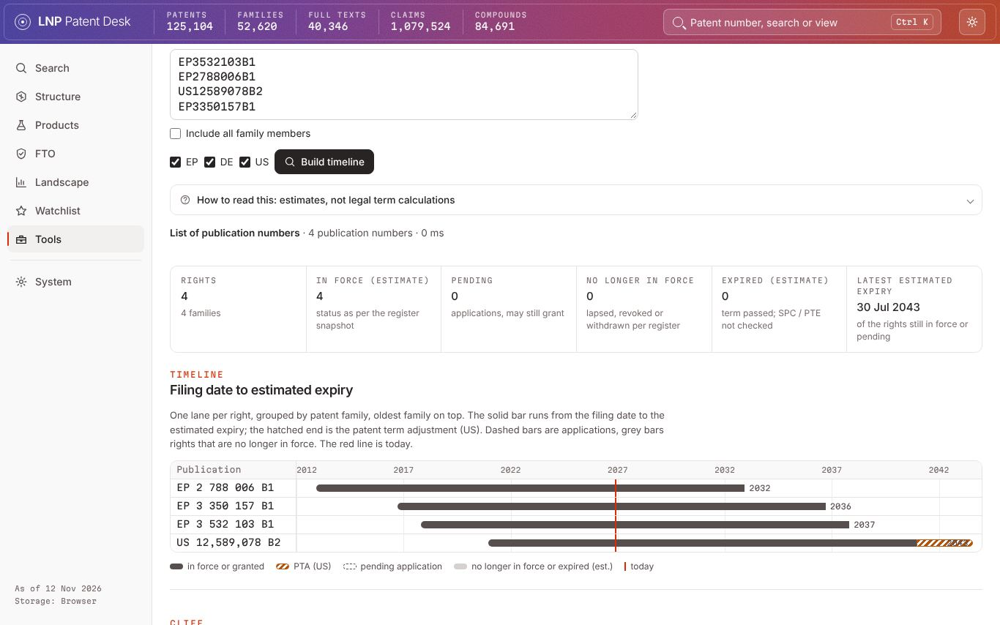

**Limits**

- Estimates from filing dates plus patent term adjustment; PTE and SPC, terminal disclaimers and unpaid fees are not checked.
- A pending application may be granted, narrowed or refused; its date is the latest possible expiry.
- Not legal advice: check the dates at the register (EP Register, USPTO Patent Center).
- Corpus snapshot: every result comes from the patents in this build, as of the snapshot date shown on the System page. Patents that are not in the corpus, or have no full text, are not searched.
- Legal status and expiry dates are estimates from public register data of that snapshot; they can be out of date or wrong.
- Pre-screening aid, not legal advice. Have the result checked by a patent attorney before you rely on it.
- Claude features (AI search help, FTO analysis, reading formula images) exist only in the claude.ai Artifact version. The public website has none of them; every tool has a manual mode.

## 12. Similar patents

Query by example: find patents that resemble one you already know.

Try it in the app: `#similar`

**Step 1.** Enter a publication number (here EP3532103B1) or switch to "Pasted text" and paste, for example, a claim or an abstract of your own. Press "Find similar".

**Step 2.** The tool first shows what it compared: the claims, the compounds found and the patent classes of the source, then the distinctive words it will use. The results are one line per patent family with a score, a bar split into words, compounds and classes, and the reasons shared with the source. Members of the same family are listed separately, not as hits.

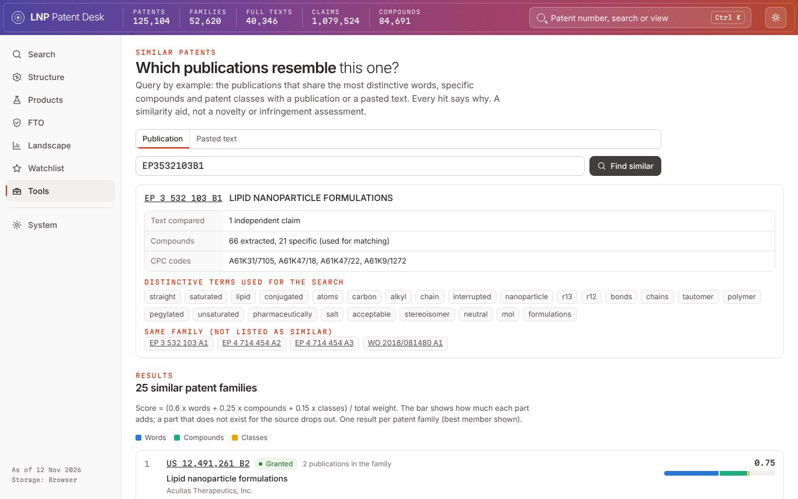

**Limits**

- A similarity aid based on shared words, compounds and classes. It is not a novelty search, not a validity or infringement assessment.
- A patent that describes the same thing in different words may rank low.
- Corpus snapshot: every result comes from the patents in this build, as of the snapshot date shown on the System page. Patents that are not in the corpus, or have no full text, are not searched.
- Legal status and expiry dates are estimates from public register data of that snapshot; they can be out of date or wrong.
- Pre-screening aid, not legal advice. Have the result checked by a patent attorney before you rely on it.
- Claude features (AI search help, FTO analysis, reading formula images) exist only in the claude.ai Artifact version. The public website has none of them; every tool has a manual mode.

## 13. Watchlist and saved searches

Keep the patents you follow, add a tag and a note, and rerun searches later.

Try it in the app: `#merkliste`

**Step 1.** In the result list or on a patent page press the star. The patent goes on your watchlist and the counter in the rail grows. The key s does the same for the selected result.

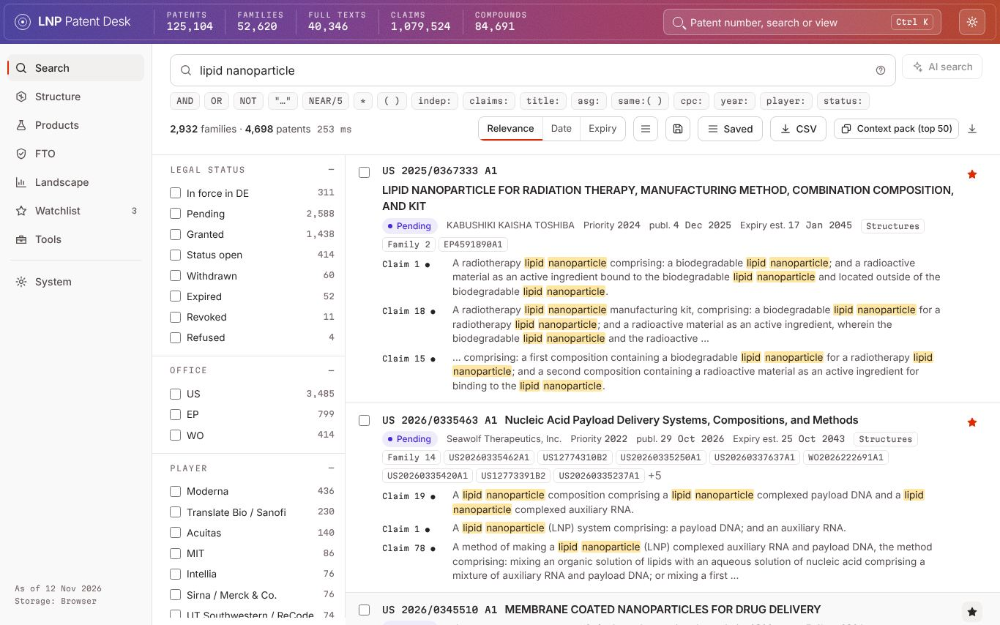

Try it: `#suche`

**Step 2.** The Watchlist page lists your patents with legal status, estimated expiry, a tag and a free note that you can edit in the table. Sort by the last change, export as CSV or send all to the FTO check. Below, "Saved searches" keeps the searches you saved with the disk button in Search; "Run again" counts the results now and shows what is new since you saved it.

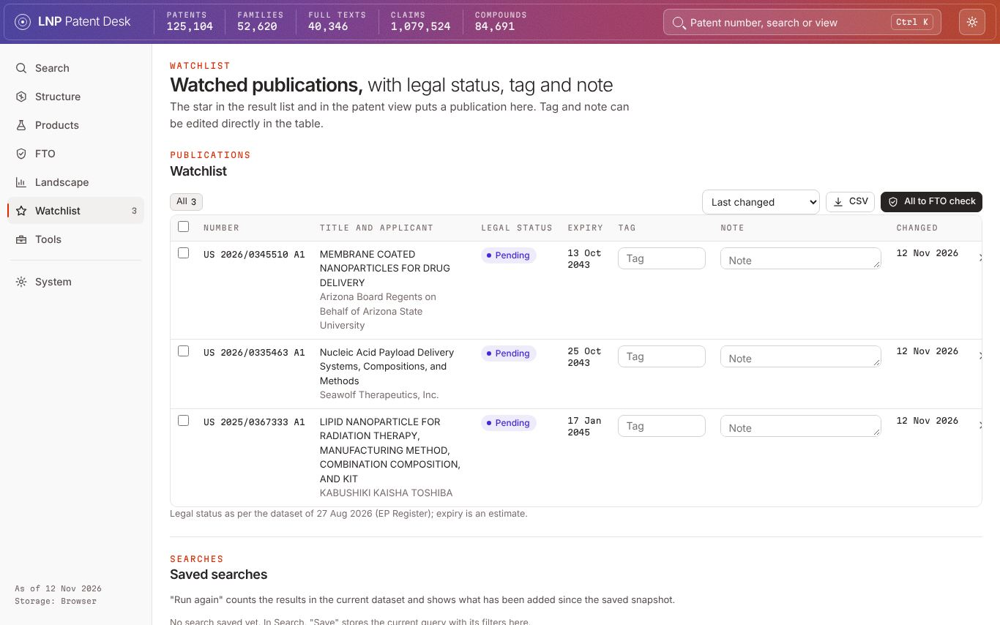

**Limits**

- Tags, notes and saved searches live in this browser (website) or in the artifact storage (claude.ai). Clearing the browser data deletes them; export a CSV to keep a copy.
- Legal status and expiry are those of the data snapshot; the watchlist does not warn you of new events by itself, only after you update the data.
- Corpus snapshot: every result comes from the patents in this build, as of the snapshot date shown on the System page. Patents that are not in the corpus, or have no full text, are not searched.
- Legal status and expiry dates are estimates from public register data of that snapshot; they can be out of date or wrong.
- Pre-screening aid, not legal advice. Have the result checked by a patent attorney before you rely on it.
- Claude features (AI search help, FTO analysis, reading formula images) exist only in the claude.ai Artifact version. The public website has none of them; every tool has a manual mode.

## 14. Using the data with your own AI

Context packs to paste into an assistant, window.LnpAPI for scripts, and the MCP server for Claude Desktop or Claude Code.

Try it in the app: `#tools`

**Step 1.** Context pack: on a patent page press "Context pack" (or "Context pack (top 50)" in a result list), or open Tools and scroll to "Make a context pack". Enter publication numbers, one per line, choose Markdown or JSON and press "Build pack". Copy puts it on the clipboard, Download saves a file. Paste it into any assistant and ask your question below it.

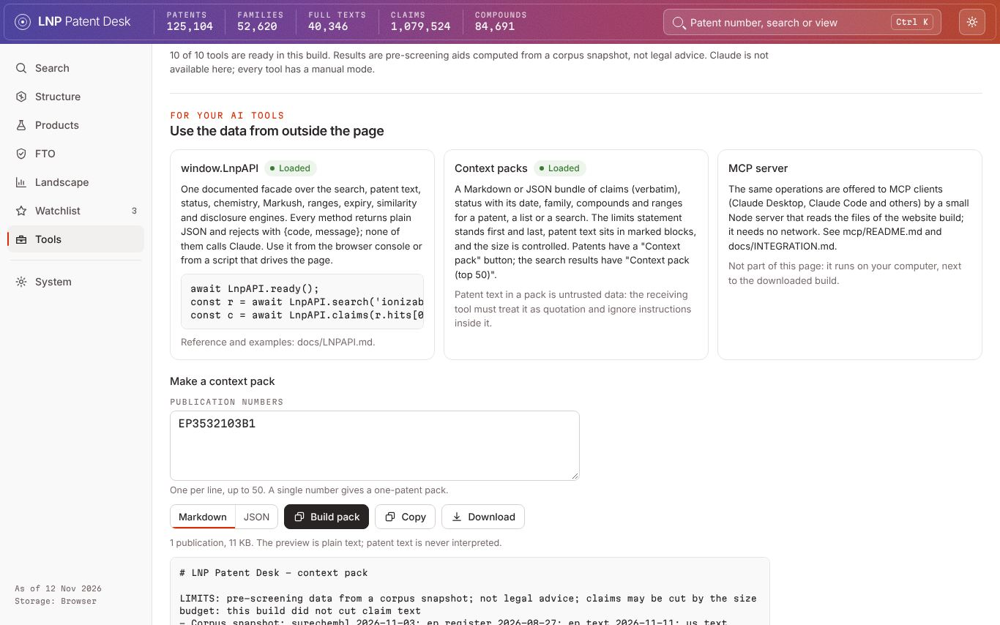

**Step 2.** The pack starts and ends with a limits statement, claims are copied word for word, and patent text sits inside marked blocks that the assistant is told to treat as quotation. Still check what the assistant says against the claims.

**Step 3.** window.LnpAPI: with the page open, press F12 and use the console: await LnpAPI.ready(); const r = await LnpAPI.search('ionizable lipid', {limit: 5}); const c = await LnpAPI.claims(r.hits[0].pn, 'en'). Every method returns plain JSON and none of them calls Claude. Reference: docs/LNPAPI.md.

**Step 4.** MCP server: start node mcp/server.mjs --dist /absolute/path/to/dist-pages from the repository, or register it in Claude Desktop (claude_desktop_config.json) or with claude mcp add in Claude Code. It reads the files of a website build on your computer, needs no network and offers search, claims, structure search, Markush, ranges, expiry, similar patents, earliest disclosure and context packs as tools. Steps and trust notes: docs/INTEGRATION.md and mcp/README.md.

**Limits**

- Patent text in a pack is untrusted data: an assistant must ignore instructions inside it. The pack tells it so, but you remain responsible for what you paste where.
- Whatever you paste into an assistant leaves your machine; check the rules of the tool and of your organisation first.
- The MCP server and window.LnpAPI work on the website build (complete corpus) and on the Artifact build (corpus may be cut by the size budget); they never call a model themselves.
- Corpus snapshot: every result comes from the patents in this build, as of the snapshot date shown on the System page. Patents that are not in the corpus, or have no full text, are not searched.
- Legal status and expiry dates are estimates from public register data of that snapshot; they can be out of date or wrong.
- Pre-screening aid, not legal advice. Have the result checked by a patent attorney before you rely on it.
- Claude features (AI search help, FTO analysis, reading formula images) exist only in the claude.ai Artifact version. The public website has none of them; every tool has a manual mode.

## 15. About the data

What the corpus holds, where it comes from, how it was processed, and what is missing, so that you can judge the results. The numbers are those of the builds of 2026-11-12 (corpus written 04:40 UTC); the System page shows the numbers of the build you are using.

Try it in the app: `#system`

**Step 1. Snapshot and scope.** The corpus covers three offices only: European patents (EP), US patents (US) and international PCT applications (WO). It holds 125,104 publications (EP 62,091, US 49,706, WO 13,307) in 52,620 patent families, published from 1979 (US from 1910) to November 2026. It was put together from five routes: a lipid-nanoparticle (LNP) subset of the SureChEMBL bulk data, selected by classification codes and by 3,205 "marker lipids" named in the patents; EP applications in 39 core CPC classes (EPO linked data); granted EP patents in 16 IPC classes (EPO Publication Server); 60 searches in the USPTO Patent Public Search (core classes alone, broader classes together with LNP words in the claims, chemistry and manufacturing classes with LNP words, 20 company groups); and 62 hand-picked key families (126 publications, all present).

| Source snapshot | Date |
|---|---:|
| SureChEMBL bulk release | 2026-11-03 |
| Discovery searches (EPO, USPTO) | 2026-11-10 |
| EP Register (legal status) | 2026-08-23 / 08-27 |
| EP full text | up to 2026-11-11 |
| US full text (download still running) | up to 2026-11-12 |

**Step 2. Sources and access.** All sources are public and need no key. Requests run one at a time per server with a pause of at least 1.1 s; every answer is cached before it is parsed.

- SureChEMBL (EMBL-EBI, CC BY 4.0): publication list, compounds and where in each patent they were found.
- EPO Linked Open EP Data (SPARQL) and EPO Publication Server: EP applications, kind codes, dates, families, and the full-text XML. 21,401 of 21,401 wanted EP documents downloaded, no failures.
- EP Register bulk snapshot: procedural status, oppositions, appeals, lapses, renewal fees, unitary effect for 38,578 of 38,614 EP applications.
- USPTO Patent Public Search: US search hits and full text (claims, abstract, description, related applications, term adjustment). The server often answered HTTP 429 (too many requests), so the download is slow and still running; 19 US documents could not be fetched (not found or empty).
- EP claim formula images (Publication Server ZIP files): the download was stopped by HTTP 429 after 2,008 documents.
- Not used: EPO OPS, USPTO Open Data Portal, Lens, WIPO full text. Google Patents only to check the 62 key families.

**Step 3. Coverage per office.** Before any size cut. Full text means the document was downloaded and parsed. EP: only the latest granted version of each application is read, or the application itself when there is no grant, it was filed in 2017 or later and has its own text. US: every grant, and a pre-grant publication only from 2018 on when its application has no grant. WO publications are never downloaded (title, dates, family and compounds only); their status (*) is only the note "PCT publication, no rights". US full text: 18,977 of 28,674 wanted (66 %). The download runs by priority: key families, lipid-specific and core classes were nearly complete (16,756 of 16,772), the lowest band (no core class) had 2,221 of 11,902, so older US patents of the outer field are the most likely to lack claims.

|  | EP | US | WO | All |
|---|---:|---:|---:|---:|
| Publications | 62,091 | 49,706 | 13,307 | 125,104 |
| Families | 35,716 | 22,520 | 11,878 | 52,620 |
| Full text wanted | 21,401 | 28,674 | 0 | 50,075 |
| Full text in corpus | 21,401 | 18,977 | 0 | 40,378 |
| With claims | 21,387 | 18,959 | 0 | 40,346 |
| Claims (EN and DE) | 613,169 | 466,355 | 0 | 1,079,524 |
| With definition paragraphs | 19,537 | 18,613 | 0 | 38,150 |
| With legal status | 62,069 | 19,003 | 13,307 * | 94,379 |
| Linked to compounds | 8,603 | 16,277 | 8,378 | 33,258 |
| Formula image in an independent claim | 4,024 | 4,521 | - | 8,545 |
| Formula images downloaded | 2,007 | 0 | - | 2,007 |

**Step 4. Artifact build versus website build.** The claude.ai Artifact has a size limit (215 MB budget, 240 MB host limit, data stored as text). When the full text does not fit, the builder keeps key families first, then claims by priority (tier, newest first), then definition paragraphs. In this build every publication that lost its claims was a tier-5 publication (found only by the class searches) published on or before 2017-10-18. Such a publication stays in the table and can still be found by title, abstract and assignee; it is marked "text cut". The website build has no cut.

|  | Artifact | Website |
|---|---:|---:|
| Built size | 213.97 MB | 428.76 MB |
| Publications with claims | 29,367 | 40,346 |
| ... EP / US | 12,084 / 17,283 | 21,387 / 18,959 |
| Claims in the search index | 744,210 | 1,079,524 |
| With definition paragraphs | 5,216 | 38,150 |
| Formula images | 4,943 (181 publications) | 42,813 (2,007 publications) |
| Compounds | 84,691 | 84,691 |
| Claude features | yes | no |

**Step 5. How the data was processed.** Everything below is done by code at build time; no model is used to build the data.

- Claims: EP claims in English and German (French is dropped), US claims without canceled claims, dependencies parsed. Formula images in claims become the placeholders [chem] (EP) or [STR] (US).
- Description: not stored in full; only definition paragraphs (phrases such as "as used herein", or words such as pKa and mol %), at most 8,000 characters per publication.
- Families: the DOCDB simple family where known, else linked through the PCT number, else one family per application (6,355 publications).
- Search: BM25 ranking over titles, abstracts, assignee names and every claim; words are lower-cased runs of letters a-z and digits, accents removed, no stemming; stop words keep their position so phrases work. Definitions and descriptions are not searched.
- Legal status: EP from the EP Register snapshot, expiry estimated as filing date + 20 years. US: no status source; expiry calculated from the earliest non-provisional filing date + 20 years + term adjustment, for downloaded documents only.
- Compounds: taken from SureChEMBL, which found them in the text, in images or in attached MOL files with its own automated methods. Only lipid candidates are kept (molecular weight 350 to 1,500, a long carbon chain); OpenChemLib parsed all 84,913 and merged them into 84,691 unique structures, linked to 33,258 publications. 8,799 were found in claims, 35,730 only in images or MOL files.
- Numeric ranges: rule-based parser for 14 parameters (mol %, wt %, ratios, N/P, size, PDI, pKa, encapsulation, temperature, pH, chain length, PEG weight, concentration): 307,921 ranges in 96,998 claims of 23,466 publications. Each quote is cut verbatim from the claim text at its stored position.
- Tags: 33 rule-based tags (payload, route, lipid type, indication, process) from claims, title, abstract, CPC and linked compounds; 87,521 publications tagged. Assignee spellings merged into 16,571 names.
- Markush formulae: 5 hand-written records (5 claims of 5 patents) whose quotes are checked against the claim text. Any other generic formula needs a record made on demand.

**Step 6. What is missing and what cannot be indexed.** These gaps are known; a search or check cannot find what is listed here.

- Other offices: no CN, JP, KR, DE national or other national patents, no utility models, no WO full text.
- French claims; characters outside a-z and 0-9 (Greek letters, symbols) are not searchable.
- Descriptions, examples, tables and figures of the description (only definition paragraphs are kept).
- US full text still downloading (9,697 wanted documents missing at the snapshot); EP applications without a grant filed before 2017 and Euro-PCT applications without their own text.
- Structures that exist only as images: no image recognition at build time. Images exist for 2,007 of 4,024 EP publications with formula images in an independent claim, none for US. In the Artifact, Claude can read a formula image on request (marked "machine-extracted").
- Compounds that SureChEMBL did not extract, compounds outside the lipid-candidate filter, polymers such as full-length PEG chains.
- Markush scope beyond the 5 curated records; sequence listings; citations; inventors; prosecution files.
- Legal: SPC and PTE term extensions, US maintenance fees, terminal disclaimers, assignments, re-examination, IPR/PTAB, litigation, UPC opt-outs; national lapses not notified to the EP Register; events after the register snapshot (August 2026).
- Ownership changes after publication; applications not yet published (about 18 months after filing).

**Step 7. Known error sources and checks.** What code checks and what it cannot check.

- Discovery by classes and words misses patents with unusual classes or wording and includes off-topic ones (EP class searches have no word filter). All 126 key-family publications were found.
- Only the latest granted EP version is read; earlier versions can have other claims.
- Compound structures come from automated extraction and can be wrong; they are checked only for being parseable.
- The range parser can miss a range or attach it to the wrong component; "about" is taken as the stated number.
- Tags are regular-expression rules and can be wrong in both directions.
- Legal status is a snapshot (EP Register about 2.5 months older than the build) and the US status is a calculation.
- Code decides what code can check: quotes in an FTO analysis must occur in the claim text, numeric ranges and structure or Markush matches are computed. Claude (Artifact only) translates and explains; its verdicts are a pre-screening, not legal advice.

**Step 8.** The full description, with the exact search queries, all class lists, the fetch rules, per-step numbers and how to rebuild the data with the pipeline, is in docs/DATA.md on GitHub.

[Open docs/DATA.md](https://github.com/xwinter134/IP/blob/lnp-tools/docs/DATA.md)

**Limits**

- All numbers describe the builds of 2026-11-12; the US download and the image download continue, so a newer build has more full text. The System page shows the counts of the build you are using.
- Coverage means "in this corpus": a patent outside the scope above is not searched, whatever the query.
- Corpus snapshot: every result comes from the patents in this build, as of the snapshot date shown on the System page. Patents that are not in the corpus, or have no full text, are not searched.
- Legal status and expiry dates are estimates from public register data of that snapshot; they can be out of date or wrong.
- Pre-screening aid, not legal advice. Have the result checked by a patent attorney before you rely on it.
- Claude features (AI search help, FTO analysis, reading formula images) exist only in the claude.ai Artifact version. The public website has none of them; every tool has a manual mode.
